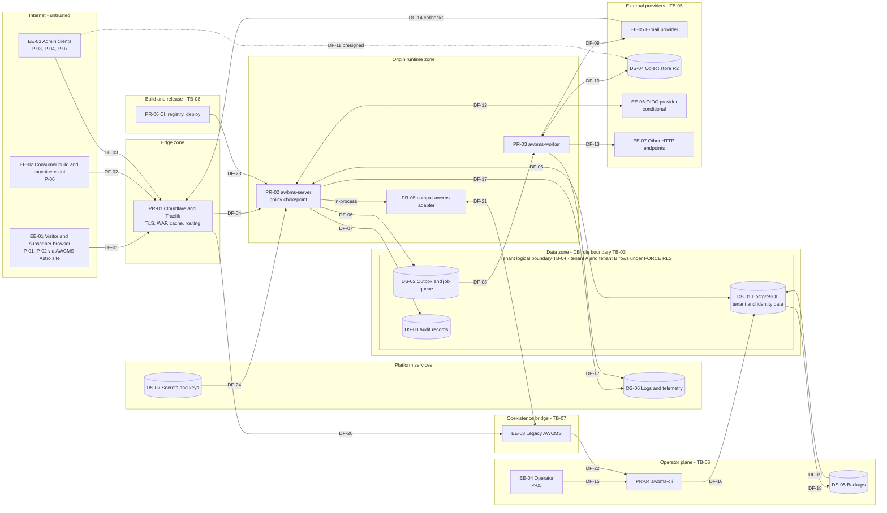

# AWBMS Initial Threat Model

| Field | Value |
|---|---|
| Status | **Draft — awaiting human security review.** An AI agent prepared this draft and does not approve it |
| Date | 2026-11-23 |
| Lifecycle step | 3 — Threat Model awal ([ADR-0004](../adr/0004-adopt-product-development-flow-v2.md)); the privacy analysis of step 3 is a separate document |
| Scope | The v1 AWBMS system of [Blueprint section 6](../architecture/AWBMS-MASTER-BLUEPRINT.md#6-system-context): the three binaries, PostgreSQL, the object store, e-mail and external provider calls, the edge, the coexistence bridge to AWCMS, the operator plane, and the build and release path. Specification only: no AWBMS runtime exists |
| Method | STRIDE per data-flow-diagram element, with trust boundaries; likelihood and impact rated L, M or H; mitigations traced to existing identifiers |
| Basis | Stage 2 PRD [AWBMS-PRD](../product/AWBMS-PRD.md), accepted by the owner on 2026-11-23: every proposed value `PD-01` to `PD-22` is accepted as proposed |
| Inputs | [Blueprint](../architecture/AWBMS-MASTER-BLUEPRINT.md), [Architecture validation](../architecture/AWBMS-RUST-ARCHITECTURE-VALIDATION.md), [User research](../product/AWBMS-USER-RESEARCH.md), [VG-01 PASS record](../architecture/evidence/VG-01-PASS-2026-11-23.md), [Stage 1 sign-off](../adr/0008-close-od-03-05-06-resolve-assumptions-sign-off-stage-1.md), [supply-chain controls](supply-chain.md), [security policy](../../SECURITY.md) |
| Implementation | **Blocked until gate 9.** This document authorises no code |

## Contents

1. [Purpose, method and conventions](#1-purpose-method-and-conventions)
2. [Data-flow diagram and trust boundaries](#2-data-flow-diagram-and-trust-boundaries)
3. [STRIDE coverage by element](#3-stride-coverage-by-element)
4. [Threat register](#4-threat-register)
5. [Summary](#5-summary)
6. [Gaps: proposed requirements and open threats](#6-gaps-proposed-requirements-and-open-threats)
7. [Open questions for the owner](#7-open-questions-for-the-owner)
8. [Security test derivation](#8-security-test-derivation)
9. [Assumptions](#9-assumptions)
10. [Out of scope](#10-out-of-scope)
11. [Limits of this draft](#11-limits-of-this-draft)

## 1. Purpose, method and conventions

This is the first threat model of AWBMS. It asks, for each element of the system as the Blueprint draws it, what an attacker, a mistake or an insider could do to it, what the signed-off architecture and the accepted PRD already do about that, and what is left. It does not decide anything: where a threat needs a control that no requirement states, it proposes requirement text (`PRQ-nn`) for a later PRD revision, and where a threat needs a choice it asks the owner ([section 7](#7-open-questions-for-the-owner)).

**Claim labels** are those of [validation section 0.2](../architecture/AWBMS-RUST-ARCHITECTURE-VALIDATION.md#02-claim-labels). In this document: **[D]** cites an existing decision (`AD-`, `OD-`, Blueprint, PD value); **[F]** is a fact read from a frozen legacy artifact in this repository, named where it is used; **[A]** is an assumption ([section 9](#9-assumptions)); **[R]** is a rating or proposal made here. Unlabelled threat text and every likelihood, impact and residual rating are **[R]**. A mitigation identifier is a citation: a gate reference (**[G]**) is not a passed gate. As of this draft no gate covering AWBMS behaviour has passed [F, validation Appendix E].

**Rating.** Likelihood (L) and impact (I) use H, M, L with a one-line reason. Risk is the inherent rating before the cited mitigations; residual is the rating assuming those mitigations are built as specified.

| Likelihood / impact | I = H | I = M | I = L |
|---|---|---|---|
| **L = H** | High | High | Medium |
| **L = M** | High | Medium | Low |
| **L = L** | Medium | Low | Low |

**Status values.**

| Status | Meaning |
|---|---|
| `mitigated-by-design` | The cited requirements and decisions already cover the threat; what remains is evidence (tests and gates), not a missing control |
| `needs-requirement` | A control is missing from the PRD; a `PRQ-` proposal is in [section 6](#6-gaps-proposed-requirements-and-open-threats) |
| `accepted` | The residual risk falls inside a recorded owner decision; a security reviewer must still confirm it |
| `open` | Needs an owner decision before a control can be proposed ([section 7](#7-open-questions-for-the-owner)) |

**STRIDE categories** in this document: Spoofing, Tampering, Repudiation, Disclosure (information disclosure), DoS (denial of service), Elevation (elevation of privilege).

## 2. Data-flow diagram and trust boundaries

The diagram is derived from [Blueprint section 6](../architecture/AWBMS-MASTER-BLUEPRINT.md#6-system-context) and extended with the operator plane, the coexistence bridge, and the build path, which the Blueprint describes in other sections. The AWCMS-Astro site host is part of the consumer, not of AWBMS, and is not drawn.

`DF-17` is drawn from both server and worker; `DF-23` and `DF-24` also reach the worker and the CLI, which the diagram omits for legibility.

### 2.1 Elements

| ID | Kind | Element | Note |
|---|---|---|---|
| `EE-01` | External entity | Visitor and subscriber browser (P-01, P-02), reaching AWBMS through the AWCMS-Astro site | Anonymous, cross-origin, fully untrusted |
| `EE-02` | External entity | Consumer build and machine client (P-06) | Holds a machine credential at build time; the consumer's CI is outside AWBMS control |
| `EE-03` | External entity | Admin clients (P-03 editors, P-04 tenant administrators; P-07 for audit and subject requests) | Session-authenticated browsers and tools |
| `EE-04` | External entity | Platform operator (P-05) | Human with CLI, hosting-console and database access |
| `EE-05` | External entity | E-mail provider | Receives mail from the worker; posts bounce and complaint callbacks |
| `EE-06` | External entity | OIDC provider (conditional on `AS-07`; scope open, see OQ-01) | Federated sign-in if enabled |
| `EE-07` | External entity | Other external HTTP endpoints reached by the worker | Destinations may be influenced by tenant configuration |
| `EE-08` | External entity | Legacy AWCMS during coexistence | Weaker, soon-retired system; source of migrated data and shadow-comparison peer |
| `PR-01` | Process | Edge: Cloudflare DNS, CDN, WAF, TLS and cache; Traefik routing | Blueprint section 6; `AD-30` |
| `PR-02` | Process | `awbms-server` (Axum and Tower; authentication, policy chokepoint, tenant-bound transactions) | Role `awbms_app` |
| `PR-03` | Process | `awbms-worker` (outbox dispatch, jobs, provider calls) | Role `awbms_worker`; calls providers after commit (`AD-15`) |
| `PR-04` | Process | `awbms-cli` (provisioning, ownership transfer, dead-letter replay, migration tooling) | Roles `awbms_operator`, `awbms_migrator`; audited surface per `REQ-083` |
| `PR-05` | Process | `compat-awcms` adapter inside the server (Blueprint section 17) | Translates legacy shapes; holds no domain rules |
| `PR-06` | Process | Build and release pipeline (CI workflows, dependency fetch, registry, deploy) | `AD-22`, `AD-30`; `vg01-freeze` is the existing privileged-workflow pattern |
| `DS-01` | Data store | PostgreSQL tenant and identity data under `FORCE` row-level security | Sessions, credentials, content, subscribers, idempotency records |
| `DS-02` | Data store | Transactional outbox and job queue (PostgreSQL tables) | Same instance as DS-01; separate element because workers consume it |
| `DS-03` | Data store | Audit records (separate store and access from logs, `REQ-023`) | Append-only by requirement (`REQ-021`) |
| `DS-04` | Data store | Object store (Cloudflare R2 behind the storage port) | Provider-held; presigned access from browsers |
| `DS-05` | Data store | Backups and archives | Separate failure domain (PRD section 7) |
| `DS-06` | Data store | Operational logs, traces and metrics | Separate retention from audit (`REQ-023`) |
| `DS-07` | Data store | Secrets, keys and runtime configuration | Injected at runtime (`AD-30`) |

### 2.2 Data flows

| ID | From | To | Content | Boundary |
|---|---|---|---|---|
| `DF-01` | EE-01 | PR-01 | Anonymous HTTPS: search, suggest, telemetry, newsletter subscribe, confirm and unsubscribe | TB-01 |
| `DF-02` | EE-02 | PR-01 | Build-time reads with a machine credential (posts, media, profile, terms, menus, widgets) | TB-01 |
| `DF-03` | EE-03 | PR-01 | Sign-in, session cookie, administrative reads and writes, media registration | TB-01 |
| `DF-04` | PR-01 | PR-02 | Proxied requests with forwarded headers; responses possibly cached at the edge | TB-02 |
| `DF-05` | PR-02 | DS-01 | SQL as `awbms_app` inside a tenant-bound transaction (both directions) | TB-03, TB-04 |
| `DF-06` | PR-02 | DS-02 | Outbox and job rows written in the business transaction | TB-03, TB-04 |
| `DF-07` | PR-02 | DS-03 | Audit rows written in the business transaction | TB-03, TB-04 |
| `DF-08` | DS-02 | PR-03 | Worker claims events and jobs as `awbms_worker` | TB-03, TB-04 |
| `DF-09` | PR-03 | EE-05 | Mail send after commit | TB-05 |
| `DF-10` | PR-03 | DS-04 | Object put, stat, get, delete (both directions) | TB-05 |
| `DF-11` | EE-03 | DS-04 | Direct upload or download through presigned URLs | TB-01, TB-05 |
| `DF-12` | PR-02 | EE-06 | OIDC authorisation and token exchange, if enabled (both directions) | TB-05 |
| `DF-13` | PR-03 | EE-07 | Outbound HTTP to attacker-influenced destinations | TB-05 |
| `DF-14` | EE-05 | PR-01 | Provider bounce and complaint callbacks | TB-01 |
| `DF-15` | EE-04 | PR-04 | Operator commands | TB-06 |
| `DF-16` | PR-04 | DS-01 | Provisioning, migration, replay as `awbms_operator` and `awbms_migrator` | TB-03, TB-06 |
| `DF-17` | PR-02, PR-03 | DS-06 | Logs, traces and metrics (OTLP) | TB-03 |
| `DF-18` | DS-01 | DS-05 | Backup and archive stream | TB-06 |
| `DF-19` | DS-05 | DS-01 | Restore | TB-06 |
| `DF-20` | PR-01 | EE-08 | Staged routing of capabilities still owned by AWCMS | TB-02, TB-07 |
| `DF-21` | PR-05 | EE-08 | Shadow reads and replay of sanitised traffic (both directions) | TB-07 |
| `DF-22` | EE-08 | PR-04 | Legacy data extract for deterministic migration | TB-07 |
| `DF-23` | PR-06 | PR-02, PR-03, PR-04 | Image build, registry push and deploy | TB-08 |
| `DF-24` | DS-07 | PR-02, PR-03, PR-04 | Runtime secret and configuration injection | TB-08 |

### 2.3 Trust boundaries

| ID | Boundary | What crosses | Flows | Threats at this boundary |
|---|---|---|---|---|
| `TB-01` | Internet and edge | Anonymous and credentialed traffic enters; browsers talk to the object store and the provider calls back | DF-01, DF-02, DF-03, DF-11, DF-14 | THR-001, THR-005, THR-006, THR-007, THR-008, THR-011, THR-012, THR-013, THR-014, THR-016, THR-017, THR-018, THR-022, THR-041, THR-042, THR-043, THR-044, THR-045, THR-046, THR-047 |
| `TB-02` | Edge and origin | Only the edge should reach the origin; cache and forwarded headers cross here; routing to legacy | DF-04, DF-20 | THR-001, THR-002, THR-003, THR-004, THR-005, THR-015, THR-028, THR-061 |
| `TB-03` | Application and database role boundary | Four roles; `NOBYPASSRLS`, non-owner, minimum DML for `awbms_app` and `awbms_worker` (Blueprint section 12) | DF-05, DF-06, DF-07, DF-08, DF-16, DF-17 | THR-009, THR-014, THR-018, THR-020, THR-021, THR-026, THR-031, THR-033, THR-035, THR-038, THR-039, THR-053, THR-059, THR-063 |
| `TB-04` | Tenant and tenant (logical) | Not a network line: tenant ID, transaction-local context and RLS inside shared processes and stores (`OD-05`) | DF-05, DF-06, DF-07, DF-08 and every derived store | THR-020, THR-021, THR-022, THR-023, THR-024, THR-025, THR-027, THR-029, THR-030, THR-032, THR-036, THR-037, THR-048 |
| `TB-05` | Server and worker to external providers | Outbound calls after commit; credentials leave the trust zone; attacker-influenced destinations | DF-09, DF-10, DF-11, DF-12, DF-13 | THR-019, THR-038, THR-040, THR-041, THR-044, THR-054 |
| `TB-06` | Operator plane | Human administrative access to roles, backups, console and CLI | DF-15, DF-16, DF-18, DF-19 | THR-026, THR-033, THR-034, THR-055, THR-056, THR-057, THR-058, THR-063 |
| `TB-07` | Coexistence bridge to AWCMS | Routing, shadow reads, extract and rollback between AWBMS and the weaker legacy system | DF-20, DF-21, DF-22 | THR-015, THR-052, THR-053, THR-057, THR-058, THR-059, THR-060, THR-061, THR-062 |
| `TB-08` | Build, release and configuration | Code and secrets move from pipeline and secret stores into runtime | DF-23, DF-24 | THR-010, THR-049, THR-050, THR-051, THR-052, THR-054 |

## 3. STRIDE coverage by element

Each cell lists the threats of [section 4](#4-threat-register) that name the element and fall in that category. A dash means no threat was identified in this draft for that pair, not that none exists; a reviewer should challenge the dashes.

| Element | S | T | R | I | D | E |
|---|---|---|---|---|---|---|
| `EE-01` Visitor and subscriber browser | 022 | 045, 047 | - | 006, 043 | 005, 044, 046 | - |
| `EE-02` Consumer build and machine client | - | 047 | 018 | 016 | 005 | 015, 017 |
| `EE-03` Admin clients | 011, 023 | 041, 047 | - | 006 | 005 | - |
| `EE-04` Platform operator | - | - | 034 | - | - | 063 |
| `EE-05` E-mail provider | 042 | - | - | 054 | 044 | - |
| `EE-06` OIDC provider | 019 | - | - | - | - | 040 |
| `EE-07` Other external HTTP endpoints | - | - | - | - | - | 040 |
| `EE-08` Legacy AWCMS | - | 052, 059, 061 | - | 058, 060 | - | 062 |
| `PR-01` Edge (Cloudflare, Traefik) | 003, 004, 042 | 001, 061 | - | 002, 006 | 005 | - |
| `PR-02` awbms-server | 003, 004, 007, 011, 019, 022, 023, 042, 048 | 001, 010, 031, 033, 038, 041, 045, 047, 051 | 018, 034 | 002, 013, 016, 021, 024, 025, 035, 036, 037, 043, 054 | 005, 008, 009, 014, 027, 044, 046 | 012, 015, 017, 028, 029, 030, 032, 040 |
| `PR-03` awbms-worker | 048 | 038, 051, 061 | - | 021, 025, 035, 054 | 027, 039, 044 | 012, 026, 040 |
| `PR-04` awbms-cli | - | 033, 051, 053, 057, 059 | 034 | 054, 058 | 039 | 020, 026, 063 |
| `PR-05` compat-awcms adapter | - | - | - | 060 | - | 015, 017, 028, 062 |
| `PR-06` Build and release pipeline | - | 049, 051, 052 | - | - | - | 050 |
| `DS-01` PostgreSQL tenant and identity data | 023, 048 | 031, 045, 053, 057, 059 | - | 021, 024, 025, 037, 043 | 014, 027, 046 | 020, 029 |
| `DS-02` Outbox and job queue | - | 038, 061 | - | 025 | 027, 039 | 020, 026 |
| `DS-03` Audit records | - | 033 | 018, 034 | 035, 036 | - | 020 |
| `DS-04` Object store | 048 | 041 | - | 025 | - | - |
| `DS-05` Backups | - | 057 | - | 055, 058 | 056 | - |
| `DS-06` Logs and telemetry | - | 045 | - | 035, 036 | - | - |
| `DS-07` Secrets and keys | - | 010 | - | 054 | 009 | - |

Cells show the numeric part of `THR-nnn`. The data flows are covered through the elements they connect and through the boundary table in [section 2.3](#23-trust-boundaries); the threat register names the flow where a threat is specific to it.

## 4. Threat register

Columns: **Element / flow** names the DFD elements; **L / I** gives likelihood and impact with a one-line reason; **Risk** is read from the matrix in [section 1](#1-purpose-method-and-conventions); **Mitigation** cites existing `REQ-`, `AD-`, `OD-`, `VG-`, `AS-`, `C-` and `PD-` identifiers and states what is not covered; **Res.** is residual risk; **Status** is defined in section 1.

### 4.1 Edge, transport and origin

| ID | Element / flow | STRIDE | Threat | Assets, personas | L / I | Risk | Mitigation | Res. | Status |
|---|---|---|---|---|---|---|---|---|---|
| `THR-001` | PR-01, DF-04 | Tampering | Edge cache poisoning or cache-key mix-up: a response that varies by Host, verified Origin, credential or query is cached without that input in the key, so one tenant's (or one credential's) response is served to another, or an attacker-influenced response is cached for everyone. | Tenant isolation of consumer reads; P-01, P-06, P-04 | M / H: Likelihood: consumer reads are edge-cached by design [A] and no requirement fixes key content. Impact: cross-tenant disclosure or defacement of a public site. | High | REQ-001, REQ-045, REQ-056, AD-18, VG-05. No REQ states what the cache key must contain. | M | needs-requirement (PRQ-01) |
| `THR-002` | PR-01, DF-04 | Disclosure | Unpublished, suspended-tenant or erased content keeps being served from the edge cache after the origin stopped serving it. | Unpublished posts; erased personal data; P-03, P-02, P-07 | M / M: Likelihood: purge is not specified and edge TTLs are provider-side. Impact: bounded exposure, but it defeats the 60 s unpublish promise. | Medium | REQ-057, REQ-004, REQ-041, PD-21, AD-18. Origin-side promises do not reach the edge copy. | M | needs-requirement (PRQ-02) |
| `THR-003` | PR-01, PR-02, DF-04 | Spoofing | A client forges X-Forwarded-For or an equivalent header so per-client limits, lockout attribution and abuse telemetry key on an attacker-chosen address. [F] The legacy limiter honours the header only when a proxy-trust flag is set and takes the entry a configured number of hops from the right, so a wrong hop count or flag defeats it. | Abuse controls of REQ-064 and REQ-066; audit attribution; P-05 | H / M: Likelihood: the header is free to forge and the hop count is deployment configuration. Impact: weakens per-client limits; per-account and per-recipient controls still hold. | High | REQ-009 (lock independent of address), REQ-065, REQ-066, AD-30. [F] `rate-limits.json` `client-ip-trust`, `client-ip-hop-count`. | M | needs-requirement (PRQ-03) |
| `THR-004` | PR-01, PR-02, DF-04 | Spoofing | The origin is reached directly (guessable address, shared network, leaked hostname), bypassing the edge WAF, rate limits and TLS policy; or request-framing ambiguity between Traefik and the Rust server (duplicate Host, Content-Length against Transfer-Encoding) lets a request be smuggled past routing or policy. | All origin controls that assume the edge; P-05 | M / H: Likelihood: origin addresses leak through DNS history and certificates. Impact: every edge-side control is skipped. | High | AD-30, AD-04, REQ-028, AS-02. Nothing requires the origin to accept only edge traffic or to reject ambiguous framing. | M | needs-requirement (PRQ-04) |
| `THR-005` | PR-01, PR-02, DF-01, DF-02, DF-03 | DoS | Volumetric, slow-body or malformed-input flood against anonymous endpoints (search, suggest, telemetry, subscribe), oversized or deeply nested bodies, or an input that triggers a panic and takes down a worker task or the process. | Availability of T2 consumer paths; P-01, P-06 | H / M: Likelihood: anonymous and internet-facing. Impact: the edge absorbs cacheable reads and the tier is T2, but a panic or pool exhaustion reaches T1. | High | REQ-028 (16 KiB anonymous, PD-19), REQ-029, REQ-064, REQ-066, REQ-072, AD-04, VG-09. AD-29 removes unsafe code, not panics. | M | mitigated-by-design |
| `THR-006` | PR-01, DF-01, DF-03 | Disclosure | Weak transport or browser-facing policy: missing TLS or HSTS, absent security headers, or CORS that reflects any Origin, or allows credentials with a broad origin list, so a hostile site can read authenticated or tenant-scoped responses. | Session and tenant data in browsers; P-03, P-04, P-01 | M / M: Likelihood: CORS is easy to get wrong on cross-origin anonymous endpoints. Impact: depends on which endpoints carry credentials. | Medium | REQ-045, REQ-068; secure headers and TLS are a baseline control in Blueprint section 19 [D] but have no REQ. | M | needs-requirement (PRQ-05) |

### 4.2 Authentication, sessions and credentials

| ID | Element / flow | STRIDE | Threat | Assets, personas | L / I | Risk | Mitigation | Res. | Status |
|---|---|---|---|---|---|---|---|---|---|
| `THR-007` | PR-02, DF-03 | Spoofing | Credential stuffing and password spraying against sign-in: many accounts, few attempts each, from many addresses. A per-account lockout does not stop spraying and per-address limits do not stop a botnet. | Editor and administrator accounts; P-03, P-04 | H / H: Likelihood: stolen credential lists are routinely replayed. Impact: a tenant administrator account is tenant takeover. | High | REQ-005, REQ-009, REQ-008, PD-08, AD-11, AD-12. REQ-009 limits per account only. | M | needs-requirement (PRQ-06) |
| `THR-008` | PR-02, DF-03 | DoS | Deliberate lockout: an attacker submits five bad passwords for known account names, including tenant administrators, and repeats every 15 minutes. | Availability of administrator access; P-04 | H / M: Likelihood: account names are guessable and the cost is five requests. Impact: blocks administration, exposes no data. | High | REQ-009 (the cause), PD-08 (owner-accepted 2026-11-23). No requirement covers detection or an audited unlock path. | M | needs-requirement (PRQ-08) |
| `THR-009` | PR-02, DS-07 | DoS | Limiter fails open: the abuse limiter depends on a shared Redis-like counter store and allows the request when a command errors or times out, so an outage or an attacker who degrades the store removes every limit at once. [F] The legacy shared limiter does exactly this (per-command timeout 250 ms) and falls back to a per-process map otherwise, so limits multiply with the number of replicas and reset at each fixed-window boundary. | Limits of REQ-009, REQ-064, REQ-066; P-02, P-04 | M / H: Likelihood: dependency outages are routine. Impact: sign-in spraying and mail-bombing limits void simultaneously. | High | AD-18, REQ-030, REQ-009, REQ-066; Blueprint section 4 (no Redis as correctness dependency) [D]. [F] VG-01 finding and `rate-limits.json` `redis-failure-is-fail-open`, `no-redis-fallback`, `algorithm`. | M | needs-requirement (PRQ-07) |
| `THR-010` | PR-02, DS-07 | Tampering | A limit is disabled by configuration error: numeric settings parsed without validation. [F] Four legacy public authentication endpoints read limits through an unvalidated `Number(env ?? default)`, so a non-numeric value disables the limit. | All limits and body or time bounds; P-05 | M / H: Likelihood: deployment configuration is hand-edited. Impact: the control is silently absent. | High | REQ-028, REQ-064, REQ-066, AD-30. [F] VG-01 finding; the legacy source also contains a validating parser, `parsePositiveIntSetting`. | M | needs-requirement (PRQ-07) |
| `THR-011` | PR-02, DF-03 | Spoofing | Session fixation, theft and CSRF against browser-held sessions: a pre-authentication token carried into the authenticated state; a token stolen through XSS, a log, a proxy or malware and replayed; a cross-site request riding a cookie. | Sessions of editors and administrators; P-03, P-04 | M / H: Likelihood: browser-held bearer state is a standing target. Impact: full account takeover for the session lifetime. | High | REQ-005, REQ-006 (5 s), REQ-007 (30 min idle, 12 h), REQ-008, REQ-027, AD-11. No REQ covers token rotation, cookie attributes or CSRF proof. A stolen token stays usable until revocation or expiry (bounded). | M | needs-requirement (PRQ-09) |
| `THR-012` | PR-02, PR-03, DF-03 | Elevation | Second-factor and recovery abuse: guessing or replaying a TOTP code, reusing a recovery code, stealing a password-reset or invitation token, a reset link built from a request-supplied Host header and mailed to the victim, reset or invitation mail flooding. [F] The legacy `password/forgot` has no recipient dimension in the inventoried code. | Account integrity; P-03, P-04 | M / H: Likelihood: recovery paths are the usual bypass. Impact: administrator takeover without the password. | High | REQ-008, REQ-006 (reset revokes sessions), AD-11, AD-15, C-07 (recipient-oriented precedent). No REQ covers reset, invitation or TOTP rules. [F] VG-01 record on `password/forgot`; the legacy source also has a per-factor lockout (default 5). | M | needs-requirement (PRQ-10) |
| `THR-013` | PR-02, DF-03 | Disclosure | Account enumeration through distinguishable sign-in, reset or invitation responses, lock reasons or timing (unknown user against wrong password). | Account existence; P-03, P-04 | H / M: Likelihood: trivially measurable. Impact: feeds stuffing and phishing; no data beyond existence. | High | REQ-009 (stable error, no lock reason), REQ-065 (newsletter equivalence), AD-21; validation section 45.5 [D]. Timing equivalence is not required anywhere. | M | needs-requirement (PRQ-11) |
| `THR-014` | PR-02, DS-01, DF-03 | DoS | Password hashing as a resource lever, and legacy-hash parameter abuse: a sign-in flood forces many memory-hard verifications (the legacy format is Argon2id m = 65536 KiB, t = 2, p = 1 [F]) and exhausts memory or CPU, or a migrated or planted hash carries extreme parameters that stall a worker. | Availability of the T1 sign-in path; P-03, P-04 | M / H: Likelihood: each attempt costs the server more than the attacker. Impact: T1 outage. | High | REQ-010 (unrecognised format refused), REQ-028, REQ-029, AD-04, AD-12, VG-09. Neither accepted parameter bounds nor hashing concurrency are specified. | M | needs-requirement (PRQ-12) |
| `THR-015` | PR-05, PR-02, DF-02, DF-04 | Elevation | Legacy credential acceptance window (OD-03, PD-09): an `awcmsm_` machine credential or an AWCMS session token stays honoured past its sunset or cutover, is accepted on an anonymous or write path, or the sunset date is moved by configuration without review. | Tenant read access; P-06, P-04, P-05 | M / H: Likelihood: the window is deliberately open and rotation depends on a third party. Impact: read access to a tenant's published content, or more on a mis-classed path. | High | REQ-011, REQ-013 (build-time reads only, sunset proposed 30 days after wave 3), REQ-047 (negative per class), OD-03, AD-24, PD-09, VG-05. Residual: a leaked legacy credential is usable inside the window. | M | mitigated-by-design |
| `THR-016` | EE-02, PR-02, DF-02 | Disclosure | Machine-credential leakage from the consumer's build environment, CI logs, repository or developer machines; a leaked credential reads the published content of its tenant until revoked. [F] Legacy credentials are `awcmsm_` plus 32 random bytes, stored as `mc-sha256:`. | Tenant content read access; P-06, P-04 | M / M: Likelihood: the credential lives in third-party CI. Impact: read-only, tenant-bound, published content only. | Medium | REQ-012 (tenant-bound, scoped, at most 365 days, revocable in 5 s), REQ-014, REQ-056, REQ-027, REQ-013. Nothing helps detect a leak. | M | needs-requirement (PRQ-13) |
| `THR-017` | PR-02, PR-05, DF-02 | Elevation | Tenant confusion or scope misuse by a machine credential: a request asserts another tenant, or a build-time credential is used on an anonymous browser path or a write path (confused deputy). | Cross-tenant and write boundaries; P-06 | M / H: Likelihood: the five execution classes behave differently and are easy to conflate. Impact: cross-tenant read or an unintended write. | High | REQ-014, REQ-012, REQ-013, REQ-047 (negative scenario per class), AD-10, VG-05, VG-07. | L | mitigated-by-design |
| `THR-018` | EE-02, PR-02, DS-03, DF-02 | Repudiation | Machine-credential actions cannot be attributed to a distinct client: one credential shared by several builds, people or environments means the audit shows only the credential, so a misuse is untraceable and deniable. | Accountability of consumer access; P-06, P-07 | M / M: Likelihood: sharing one credential across builds is convenient. Impact: weaker forensics, no direct data loss. | Medium | REQ-012 (purpose-specific, tenant-bound), REQ-020, REQ-022, AD-10; Blueprint section 13 (purpose-specific credentials) [D]. Per-credential attribution in audit follows from REQ-020 once credentials are issued per client. | L | mitigated-by-design |
| `THR-019` | PR-02, EE-06, DF-12 | Spoofing | OIDC federation flaws, if SSO is in scope: missing state, nonce or PKCE checks, issuer mix-up, account linking by an unverified e-mail claim, SSRF through a discovery URL. The PRD has no federation requirement, yet legacy SSO client secrets are migrated (REQ-084). | Account integrity; P-03, P-04 | M / H: Likelihood: unknown until scope is decided. Impact: account takeover through the identity provider. | High | AS-07 (assumes a provider), REQ-084, AD-11 (JWT only for OIDC). No requirement or test target exists. See OQ-01. | H | open |

### 4.3 Tenancy and isolation

| ID | Element / flow | STRIDE | Threat | Assets, personas | L / I | Risk | Mitigation | Res. | Status |
|---|---|---|---|---|---|---|---|---|---|
| `THR-020` | DS-01, DS-02, DS-03, PR-04, DF-05, DF-16 | Elevation | Isolation silently disabled by database configuration: an application or worker role gains BYPASSRLS or superuser, or becomes a table owner; a table ships without RLS (the legacy inventory has 18 RLS-free global tables by design [F, Blueprint section 2.2]); a view or SECURITY DEFINER function runs with owner rights; migration grants drift. | All tenant data; P-04, P-07 | M / H: Likelihood: roles and grants change in migrations by hand. Impact: every tenant exposed through one defect. | High | AD-10, REQ-001 (holds even when a layer is defective), VG-06 (role and policy introspection), AD-25, VG-10, Blueprint section 12 roles [D]. No REQ makes every table classified or constrains views and definer functions. | M | needs-requirement (PRQ-14) |
| `THR-021` | PR-02, PR-03, DS-01, DF-05, DF-08 | Disclosure | Tenant context absent, stale or leaked: a code path runs without the transaction-local tenant, a session-level (not LOCAL) setting survives on a pooled connection, or a cancelled task leaves context on a connection reused by another tenant's request. | All tenant data; P-04 | M / H: Likelihood: a single missed call site is enough. Impact: cross-tenant read or write. | High | Blueprint section 12 (transaction-local, tenant-bound abstraction) [D], REQ-001, REQ-016 (missing context denies), AD-10, AD-06, VG-06; VG-04 (PASS) shows composition only. Test with the real application role and pooled connections. | L | mitigated-by-design |
| `THR-022` | PR-02, DF-01, DF-04 | Spoofing | Tenant spoofing by Host, Origin or a tenant header: non-browser clients can send any Origin, so Origin is a routing hint and not authentication. An attacker selects another tenant's public data, probes tenant existence, or makes a newsletter write appear to come from a tenant origin it does not control. | Tenant resolution; P-01, P-02, P-06 | H / M: Likelihood: Origin is trivially forged. Impact: public data only; write abuse is bounded by limits, not prevented. | High | REQ-045 (verified origin, nothing on unknown), REQ-068, REQ-056, REQ-058 (published only), REQ-065, REQ-066, AD-10, VG-05. [A] Content returned to anonymous callers is public by design. | M | mitigated-by-design |
| `THR-023` | PR-02, DS-01, DF-03 | Spoofing | Custom-domain takeover: a tenant administrator registers a domain it does not control; a verified domain lapses or its DNS changes and an attacker re-registers it and thereby resolves to the tenant; one domain is claimed by two tenants. | Tenant resolution; P-04, P-06 | M / M: Likelihood: domains lapse in practice. Impact: attacker sites act with a tenant's identity toward subscribers and anonymous writes. | Medium | REQ-046 (proof of control before activation), REQ-045, AD-10. No re-verification and no one-domain-one-tenant rule. | M | needs-requirement (PRQ-15) |
| `THR-024` | PR-02, DS-01, DF-02, DF-03, DF-05 | Disclosure | Object-level cross-tenant access (BOLA/IDOR): guessed or enumerated identifiers of posts, media, users, credentials or jobs submitted by a principal of another tenant, or without ownership inside a tenant. | All tenant objects; P-04, P-06, P-07 | H / H: Likelihood: attempted routinely against multi-tenant APIs. Impact: direct cross-tenant disclosure. | High | REQ-001 (negative scenario: predicate removed, 0 rows), REQ-016, REQ-022, AD-10, VG-06, VG-07; Blueprint section 24 example 1 [D]. | L | mitigated-by-design |
| `THR-025` | DS-01, DS-02, DS-04, PR-02, PR-03 | Disclosure | Derived stores and keys without a tenant dimension: search index entries, cache entries, analytics aggregates, outbox payloads, object keys, idempotency records and exports hold or key data without tenant scope or RLS, so reads bypass the three layers. | Derived copies of tenant data; P-04, P-07 | M / H: Likelihood: RLS covers PostgreSQL tables only and the search store is undecided (OD-07). Impact: cross-tenant disclosure outside the policed path. | High | REQ-001, REQ-030, REQ-041 (derived copies), AD-09, AD-18, OD-07, VG-06, VG-14. No rule for non-table stores. | M | needs-requirement (PRQ-16) |
| `THR-026` | PR-03, DS-02, DF-08, DF-16 | Elevation | Worker and maintenance paths without proper tenant context: jobs, retention purges, schedulers and replay tools need cross-tenant visibility, which tempts use of a bypass or operator role, or runs one tenant's job under another's context. | All tenant data; P-05, P-07 | M / H: Likelihood: scheduler-style scans are inherently cross-tenant. Impact: cross-tenant read or write through a privileged path. | High | Blueprint section 15 (tenant context in the job definition) [D], AD-14, AD-10, REQ-001, REQ-036, VG-06, VG-11. How a cross-tenant scan runs is unspecified. | M | needs-requirement (PRQ-17) |
| `THR-027` | PR-02, PR-03, DS-01, DS-02, DF-05, DF-08 | DoS | Noisy neighbour and pool exhaustion: one tenant, or an attacker through a tenant's public endpoint, consumes the shared database pool, queue throughput or storage and degrades every tenant of the one shared deployment (OD-05); long transactions and lock waits. | Availability of all tenants; P-04, P-05 | M / H: Likelihood: one shared pool by design. Impact: T1 degradation across tenants. | High | REQ-029, REQ-028, REQ-073, REQ-064, AD-04, OD-05, VG-09. No per-tenant quota. | M | needs-requirement (PRQ-18) |

### 4.4 Authorisation

| ID | Element / flow | STRIDE | Threat | Assets, personas | L / I | Risk | Mitigation | Res. | Status |
|---|---|---|---|---|---|---|---|---|---|
| `THR-028` | PR-02, PR-05, DF-03, DF-04 | Elevation | Authorisation chokepoint bypass: a route, background path, internal endpoint, compat-adapter alias or module route reachable without the central decision; a module disabled for a tenant that is still reachable; missing context handled as allow. | All protected operations; P-04, P-07 | M / H: Likelihood: every wave adds routes and the adapter adds aliases. Impact: unauthorised operation. | High | REQ-016, REQ-019, REQ-025, REQ-050, AD-10, AD-08, AD-24, VG-07, VG-08. Static route-to-policy check is the load-bearing control. | L | mitigated-by-design |
| `THR-029` | PR-02, DS-01, DF-03 | Elevation | Privilege escalation: an administrator grants roles or permissions it does not itself hold, approves its own grant (SoD), relies on an implicit admin role, or the SoD catalogue misses a conflicting pair (PD-17 starts with one pair). | Authorisation model; P-04, P-07 | M / H: Likelihood: grant paths are the classic escalation. Impact: unbounded privilege inside a tenant. | High | REQ-017, REQ-018, REQ-008, AD-10, PD-17, VG-07. No amplification rule. | M | needs-requirement (PRQ-19) |
| `THR-030` | PR-02, DF-02, DF-03 | Elevation | Stale authorisation: a revoked role, removed membership, revoked credential, suspended tenant or disabled module stays effective through cached decisions or in-flight sessions, or a cache loss defaults to allow. | Revocation guarantees; P-04, P-05 | M / H: Likelihood: caching is the usual cause. Impact: access continues after an administrator believed it stopped. | High | REQ-004 (60 s), REQ-006 (5 s), REQ-012, REQ-019, REQ-026, REQ-030, AD-11, AD-18, VG-05, VG-07. Bounded windows are accepted by PD-07. | L | mitigated-by-design |
| `THR-031` | PR-02, DS-01, DF-05 | Tampering | SQL injection or unsafe dynamic SQL: string-built identifiers, ORDER BY or filter clauses, or LIKE and tsquery strings passed unescaped. | All tenant data; P-04, P-07 | L / H: Likelihood: typed binding is the default but dynamic sort and filter are where it breaks. Impact: RLS and minimum DML limit but do not remove the damage. | Medium | AD-06 (SQL stays visible and reviewed), Blueprint section 19 (safe SQL binding) [D], VG-02, VG-06. The application role has minimum DML (Blueprint section 12). | L | mitigated-by-design |
| `THR-032` | PR-02 | Elevation | In-process derived-module code (P-08) inherits the server's privileges, so a defective or hostile module can call any internal port or read all tenants within RLS limits; the controls are admission review, not isolation. | Whole deployment; P-05, P-08 | L / H: Likelihood: PD-22 keeps module admission internal in v1. Impact: all in-process privilege. | Medium | AD-07, AD-08 (compile-time registry), AD-09, REQ-025, REQ-040, PD-22, VG-02. Revisit if P-08 enters scope. | M | accepted |

### 4.5 Audit and telemetry

| ID | Element / flow | STRIDE | Threat | Assets, personas | L / I | Risk | Mitigation | Res. | Status |
|---|---|---|---|---|---|---|---|---|---|
| `THR-033` | DS-03, PR-02, PR-04, DF-07 | Tampering | Audit tampering: an application role, tenant administrator or database administrator updates or deletes audit rows, drops history early, or alters it through restore or migration. | Audit integrity; P-07, P-05 | M / H: Likelihood: privileged database access exists. Impact: loss of accountability and of forensic value. | High | REQ-021, REQ-020 (atomic), REQ-023 (separate store and access), AD-10, VG-06 (grants). A superuser or a restore can still rewrite history; there is no tamper evidence. | M | needs-requirement (PRQ-20) |
| `THR-034` | PR-02, PR-04, DS-03, DF-15, DF-16 | Repudiation | A privileged or security-relevant operation without an attributable audit record: a path outside the audited chokepoint, an operator action through direct database or hosting-console access instead of the audited CLI, shared operator accounts, or an audit write that fails open. | Accountability; P-05, P-07 | M / H: Likelihood: break-glass access always exists. Impact: untraceable change to production. | High | REQ-020, REQ-022, REQ-083 (audited CLI only), REQ-017, AD-10, AD-20, VG-07. REQ-083 does not cover direct database or console access. | M | needs-requirement (PRQ-21) |
| `THR-035` | PR-02, PR-03, DS-06, DS-03, DF-17 | Disclosure | Secrets, tokens, personal data or internals leak through logs, traces, metrics, panic messages, error envelopes, provider-error echo or audit details; untrusted values (CR/LF, very long strings, markup) forge or flood log lines. | Credentials and personal data; P-07, P-05 | H / H: Likelihood: the commonest operational leak. Impact: credential exposure into broadly readable stores. | High | REQ-027 (canary), REQ-049 (stable envelope), REQ-022, AD-20, AD-21, VG-02, VG-08; provider error redaction in Blueprint section 16 [D]. A canary finds only known patterns; no rule bounds or encodes untrusted log fields. | M | needs-requirement (PRQ-22) |
| `THR-036` | DS-03, DS-06, PR-02 | Disclosure | Audit or operational-log read by the wrong party: a tenant administrator reads another tenant's audit, an operational-log reader role reads audit, or telemetry viewers see personal data. | Audit and log content; P-04, P-07 | L / H: Likelihood: separation is explicit. Impact: cross-tenant or audit disclosure. | Medium | REQ-023, REQ-024 (own tenant only), REQ-001, REQ-027, AD-20, VG-06. | L | mitigated-by-design |

### 4.6 Durable runtime (outbox, jobs, idempotency)

| ID | Element / flow | STRIDE | Threat | Assets, personas | L / I | Risk | Mitigation | Res. | Status |
|---|---|---|---|---|---|---|---|---|---|
| `THR-037` | PR-02, DS-01, DF-02, DF-03 | Disclosure | Idempotency-key replay across principals or tenants: a key reused or guessed by another principal returns the stored response of the first, leaking its body; a key reused with different content; a stored response outliving its purpose (24 h). | Stored responses; P-06, P-05 | L / M: Likelihood: keys are bound to tenant, principal and fingerprint [D]. Impact: leakage of one mutation's response. | Low | REQ-038, REQ-039, AD-23, VG-11. | L | mitigated-by-design |
| `THR-038` | PR-02, PR-03, DS-02, DF-06, DF-08, DF-09 | Tampering | Double processing: concurrent identical requests, two workers claiming one job, a worker crash after the provider call and before acknowledgement, or a dispatcher duplicate produce two effects (two e-mails, a repeated mutation). | Business integrity; P-05, P-02 | M / M: Likelihood: crash windows exist in any at-least-once design. Impact: duplicates, not loss. | Medium | REQ-033, REQ-034 (at-least-once, identifier for deduplication), REQ-036, REQ-038, AD-13, AD-14, AD-15, AD-23, VG-11. Provider-side duplicates after a crash are inherent to at-least-once delivery. | L | mitigated-by-design |
| `THR-039` | PR-03, DS-02, DF-06, DF-08 | DoS | Poison payload and dead-letter abuse: a crafted event or job payload (oversized, schema-invalid, a deserialisation edge case) crashes or stalls consumers in a retry loop and blocks the queue head; dead-letter flooding hides real failures; replay re-injects the poison. | Queue availability; P-05 | M / M: Likelihood: payloads carry tenant-influenced content. Impact: delayed async work (T3). | Medium | REQ-035 (8 attempts, dead-letter, audited replay), REQ-036, REQ-083, AD-13, AD-14, PD-18, VG-11. | L | mitigated-by-design |

### 4.7 Integrations and public abuse surfaces

| ID | Element / flow | STRIDE | Threat | Assets, personas | L / I | Risk | Mitigation | Res. | Status |
|---|---|---|---|---|---|---|---|---|---|
| `THR-040` | PR-03, PR-02, DF-12, DF-13 | Elevation | SSRF through integrations and media fetch: an attacker-influenced destination (tenant-configured URL, remote media fetch, OIDC discovery, redirect, DNS rebinding) reaches cloud metadata, loopback or the internal network, or exfiltrates credentials. | Internal network; secrets; P-05 | M / H: Likelihood: any tenant-influenced URL qualifies. Impact: internal access and credential theft. | High | AD-16, REQ-037; SSRF controls are named in Blueprint sections 16 and 19 [D] but not specified. | M | needs-requirement (PRQ-23) |
| `THR-041` | PR-02, DS-04, DF-10, DF-11 | Tampering | Upload and presigned-URL abuse: active content (SVG, HTML) or polyglots served from the public media origin (stored XSS), content-type spoofing, oversized files and quota exhaustion, presigned URLs not bound to key, size, type and expiry, embedded personal metadata published. | Media library; public sites; P-03, P-01 | M / M: Likelihood: uploads are a standing abuse surface. Impact: stored XSS on tenant sites; storage cost. | Medium | REQ-053 (checksum and metadata verified), REQ-028, REQ-052, REQ-054, AD-17, AS-07. No type validation, serving-origin, presign or quota rule. | M | needs-requirement (PRQ-24) |
| `THR-042` | PR-01, PR-02, EE-05, DF-14 | Spoofing | Forged provider callbacks: unauthenticated bounce or complaint notifications suppress legitimate addresses (silencing mail to chosen subscribers) or trigger work; replayed callbacks. | Newsletter delivery; P-02, P-05 | M / M: Likelihood: webhook URLs are guessable. Impact: targeted suppression, not disclosure. | Medium | REQ-071, AD-17, AS-07, REQ-028. Authenticity of callbacks is unspecified. | M | needs-requirement (PRQ-25) |
| `THR-043` | PR-02, DS-01, DF-01 | Disclosure | Newsletter enumeration and token abuse: differences in response or timing reveal whether an address is subscribed; confirm and unsubscribe tokens are brute-forced or replayed; legacy tokens accepted for their remaining validity (REQ-069) are stored as an unsalted SHA-256 hex digest (`confirmation_token_hash`), so a database read exposes only digests of high-entropy tokens. [F] Legacy tokens are 32 random bytes; confirm and unsubscribe are limited per client only. | Subscriber list; P-02 | H / M: Likelihood: enumeration is cheap; guessing 32 random bytes is infeasible. Impact: subscriber existence and unsolicited changes. | High | REQ-065, REQ-067, REQ-066 (subscribe only), REQ-068, REQ-069, C-07, PD-10, AD-15. [F] `rate-limits.json` buckets; `credential-formats.json` `newsletter-subscription-token` (32 random bytes; SHA-256, hex, unsalted). | M | needs-requirement (PRQ-26) |
| `THR-044` | PR-02, PR-03, EE-05, DF-01, DF-09 | DoS | Mail-bombing and sender-reputation damage: an attacker subscribes a victim from many clients, defeating the per-client limit, or through many tenants whose cooldowns are independent, flooding the victim and getting the shared sending domain blocklisted for every tenant. [F] The legacy recipient cooldown is keyed on tenant and normalised address. | Victim mailbox; mail reputation of all tenants; P-02, P-05 | H / M: Likelihood: botnets and many tenants make it cheap. Impact: harassment and shared-reputation loss. | High | REQ-065 (one per recipient per 15 minutes, scope across tenants not stated), REQ-066, REQ-070, REQ-071, C-07, PD-10, AD-15. [F] `rate-limits.json` `newsletter-recipient-cooldown`. | M | needs-requirement (PRQ-27) |
| `THR-045` | PR-02, DS-01, DS-06, DF-01 | Tampering | Analytics abuse and privacy: forged telemetry poisons aggregates or fills storage; crafted events attribute traffic to another tenant; coarse fields (user agent, time, path, geography) in combination re-identify visitors; the raw address survives in edge or proxy logs. | Analytics integrity; visitor privacy; P-01, P-06, P-07 | H / M: Likelihood: anonymous and free. Impact: bad statistics; re-identification risk is the weightier harm. | High | REQ-062, REQ-063, REQ-064, REQ-041 (90-day purge), PD-10, PD-15, AD-04, VG-14. Poisoning of anonymous statistics is accepted as inherent [A]; privacy treatment continues in the privacy analysis produced alongside this model. | M | mitigated-by-design |
| `THR-046` | PR-02, DS-01, DF-01 | DoS | Search injection and expensive queries: tsquery or LIKE operator injection, very long or many-term queries, deep pagination, fuzzy matching and suggest-as-you-type amplify load; draft content leaks through the index. | Search availability; unpublished content; P-01, P-06 | H / M: Likelihood: anonymous endpoint with per-keystroke traffic. Impact: latency or outage of the search path; draft leak is the weightier harm. | High | REQ-058, REQ-059, REQ-057, REQ-028, REQ-029, AD-06, OD-07, VG-09. No bound on query shape or statement time. | M | needs-requirement (PRQ-28) |
| `THR-047` | PR-02, DF-02, DF-03 | Tampering | Stored content attack on consumers: editor-supplied (or compromised-editor) HTML or Markdown in posts, terms, menus and widgets is delivered through the API and rendered by the consumer site, producing stored XSS, malicious links or tracking pixels on a tenant's public site. | Public sites; P-01, P-03, P-06 | M / H: Likelihood: editors are a phishing target. Impact: script on a public tenant site. | High | REQ-055 (changes audited), REQ-056 (frozen shape), REQ-048, AD-19. Responsibility for sanitisation between AWBMS and the consumer is undefined. See OQ-02. | H | open |
| `THR-048` | PR-02, PR-03, DS-01, DS-04 | Spoofing | Data-subject and lifecycle abuse: a forged export or erasure request for another person's data (disclosure or malicious erasure); a purge that over-reaches or ignores a legal hold; erasure that leaves derived copies. | Personal data; P-02, P-07 | M / H: Likelihood: requests arrive by e-mail from anyone. Impact: disclosure of a person's data, or loss of data under hold. | High | REQ-040, REQ-041, REQ-042, REQ-043, PD-12, VG-14. Authentication of the requester to the subject is not specified. | M | needs-requirement (PRQ-29) |

### 4.8 Supply chain, build and secrets

| ID | Element / flow | STRIDE | Threat | Assets, personas | L / I | Risk | Mitigation | Res. | Status |
|---|---|---|---|---|---|---|---|---|---|
| `THR-049` | PR-06 | Tampering | Dependency compromise: a malicious or typosquatted crate, a compromised maintainer, a build script or procedural macro that runs at build time, or a vulnerable or yanked crate in a graph of roughly 140 crates [F, supply-chain page]. | Every runtime; P-05 | M / H: Likelihood: large transitive graph. Impact: code execution in build or runtime. | High | REQ-031, AD-22, AD-29 (first-party only), AD-16, OD-02, VG-13. [F] Enforced today: locked graph, exact pins, `cargo deny`, `cargo audit`, scheduled re-check, SHA-pinned actions. Deferred: SBOM, signing, `cargo vet`. | M | mitigated-by-design |
| `THR-050` | PR-06, DF-23 | Elevation | CI and workflow token abuse: untrusted pull-request code or workflow-input injection runs with a write token; mutable action tags; secrets exposed to fork builds; a publish job that also installs dependencies lets build code push to main. [F] The `vg01-freeze` workflow shows the intended pattern: a read-only generate job with attestation, a write-capable publish job with no dependency install or build, environment approval, a fail-closed `git status` check, and no push to main. | Repository integrity; release path; P-05 | M / H: Likelihood: workflows with write tokens multiply at release and deploy. Impact: unreviewed code reaches main or production. | High | AD-22, VG-13, VG-15; the `vg01-freeze` pattern and SHA-pinned actions with read-only default permissions are [F]. The pattern exists for one workflow only. | M | needs-requirement (PRQ-30) |
| `THR-051` | PR-06, DF-23 | Tampering | Artifact tampering between build and deploy: unsigned or tag-addressed images, a compromised registry, or a deployment of an image not built from the reviewed commit. [F] SBOM, signing and provenance are deferred until the first release artifact. | Running code; P-05 | L / H: Likelihood: needs registry or pipeline compromise. Impact: attacker code in production. | Medium | REQ-031 (SBOM per release), AD-22, AD-30 (immutable digest promotion, Blueprint section 22 [D]), VG-13. Verification at deploy is unspecified. | M | needs-requirement (PRQ-31) |
| `THR-052` | PR-06, EE-08 | Tampering | Frozen legacy fixture poisoning: an altered corpus or manifest changes the parity baseline, hiding a regression or planting an accepted behaviour. | Parity evidence; P-05, P-06 | L / H: Likelihood: publication is attested and approval-gated [F]. Impact: false parity confidence. | Medium | AD-24, VG-01 (PASS: SHA-256 manifest, provenance, orphan and stale checks), VG-05, VG-15; publication procedure with attestation and environment approval [F]. | L | mitigated-by-design |
| `THR-053` | DS-01, PR-04, DF-16, DF-22 | Tampering | Inherited storage weaknesses: sensitive columns stored without encryption and credential hash columns without a format check. [F] The legacy push `auth_secret` is stored unencrypted, OIDC nonce and code verifier are plaintext, and session hashes (`sha256:`) have no CHECK while machine hashes (`mc-sha256:`) do, so a malformed or planted row is accepted. | Credential integrity; P-03, P-06 | M / M: Likelihood: carried over by migration unless prevented. Impact: weakened credential checks and at-rest exposure. | Medium | OD-03 (push `auth_secret` migrated encrypted, OIDC values not migrated), REQ-084, REQ-005, VG-10, VG-06. [F] VG-01 findings. No general rule. | M | needs-requirement (PRQ-32) |
| `THR-054` | DS-07, PR-02, PR-03, PR-04, DF-24 | Disclosure | Secrets and key management: key material, provider API keys (e-mail, object store), database passwords and the re-encryption key for migrated MFA and SSO secrets exposed through the repository, image layers, compose or hosting settings, process listings, or over-privileged provider tokens (an object-store token that can list or delete every bucket). | All credentials and encrypted secrets; P-05, P-07 | M / H: Likelihood: runtime injection still lands in an environment. Impact: provider takeover and decryption of migrated secrets. | High | REQ-084, REQ-027, AD-30 (runtime-injected secrets), AD-17, AD-22; Blueprint section 22 [D]. No key hierarchy, rotation or least-privilege rule. | M | needs-requirement (PRQ-33) |

### 4.9 Backup, restore and recovery

| ID | Element / flow | STRIDE | Threat | Assets, personas | L / I | Risk | Mitigation | Res. | Status |
|---|---|---|---|---|---|---|---|---|---|
| `THR-055` | DS-05, DF-18, DF-19 | Disclosure | Backup exfiltration: backups hold every tenant, credential hashes and encrypted secrets, and are stolen from storage, from a restore host or through over-broad access. | All tenant data; P-07, P-05 | M / H: Likelihood: backups are reachable by more people and hosts than the database. Impact: all tenants at once. | High | REQ-075, AD-28, REQ-084, VG-12; separate failure domain is stated in PRD section 7 [D]. Encryption, key separation and access control are not specified. | M | needs-requirement (PRQ-34) |
| `THR-056` | DS-05, DF-18 | DoS | Backup destruction or corruption: ransomware or a compromised credential deletes or poisons backups and archived logs together with the primary; restore never rehearsed. | Recoverability; P-05 | L / H: Likelihood: needs a privileged credential. Impact: unrecoverable loss. | Medium | REQ-075, AD-28, VG-12, PD-01, PD-20. No immutability or separate-credential rule. | M | needs-requirement (PRQ-34) |
| `THR-057` | DS-05, PR-04, DF-19, DF-20 | Tampering | Restore or rollback resurrects state: restoring to an earlier point revives erased personal data, revoked sessions and credentials, un-suspended tenants and released legal holds; rolling a capability back to AWCMS re-enables legacy credentials that were revoked in AWBMS. | Revocation and erasure guarantees; P-07, P-04 | M / H: Likelihood: restore and rollback are rehearsed events. Impact: reversal of security decisions. | High | REQ-044 (erasure only), REQ-081, REQ-011, REQ-006, REQ-004, AD-28, VG-12, VG-14. No revocation ledger. | M | needs-requirement (PRQ-35) |
| `THR-058` | DS-05, PR-04, EE-08, DF-21, DF-22 | Disclosure | Production-like copies outside production controls: rehearsal snapshots, shadow-replay databases, parity corpora and migration intermediates (extracts holding password hashes and, during re-encryption, decrypted MFA and SSO secrets) sit on weaker hosts, in CI artifacts or on developer machines. AS-03 and REQ-075 require production-like snapshots. | Credentials and personal data in copies; P-05, P-07 | M / H: Likelihood: copies are made for convenience. Impact: a full data set outside the hardened path. | High | AS-03, REQ-075, REQ-078, REQ-084, VG-12, VG-10. The requirements demand real data and do not say how it is protected. See OQ-03. | H | open |

### 4.10 Migration and coexistence

| ID | Element / flow | STRIDE | Threat | Assets, personas | L / I | Risk | Mitigation | Res. | Status |
|---|---|---|---|---|---|---|---|---|---|
| `THR-059` | PR-04, DS-01, DF-16, DF-22 | Tampering | Migration data corruption: the ETL maps rows to the wrong tenant, loses or duplicates rows, truncates fields, mishandles encoding or identifier collisions, producing cross-tenant contamination or lost records that look valid. | Migrated data; P-04, P-05 | M / H: Likelihood: first-time bulk transformation. Impact: cross-tenant contamination persisting into production. | High | REQ-078 (deterministic, reconciled), REQ-079, AD-25, AD-27, OD-01, VG-10, VG-05. | L | mitigated-by-design |
| `THR-060` | PR-05, EE-08, DF-20, DF-21 | Disclosure | Shadow-traffic and replay leakage: shadow reads and replayed requests carry credentials and personal data into a second system; captured corpora store tokens and personal data; replayed writes cause real side effects (mail sent, webhook fired). | Credentials and personal data in flight and at rest; P-05, P-02 | M / H: Likelihood: replay corpora are built from production traffic. Impact: credential and personal-data exposure; unintended mail. | High | REQ-080, REQ-079, REQ-037, AD-26, VG-05; captured and sanitised writes into isolated databases is Blueprint section 9 rule 4 [D]. No sanitisation or stubbing rule. | M | needs-requirement (PRQ-36) |
| `THR-061` | PR-01, PR-03, DS-02, EE-08, DF-20 | Tampering | Split-brain ownership: during staged routing, stale DNS or a cached route, both systems accept writes or claim the same queue, so a capability or job has two owners and writes or jobs are lost or duplicated. | Write integrity; P-05, P-02 | M / H: Likelihood: staged cutover has transitional states. Impact: lost or duplicated writes. | High | REQ-079, REQ-082, REQ-081, AD-27, AS-08, VG-12, VG-11. | L | mitigated-by-design |
| `THR-062` | PR-05, EE-08, DF-20, DF-21, DF-22 | Elevation | Coexistence bridge pivot: a channel between AWBMS and AWCMS (shadow reads, extract, shared credentials or database roles) lets a weaker or compromised legacy system reach AWBMS data, or makes AWBMS trust legacy-asserted identity or tenant. | AWBMS data and trust decisions; P-05 | L / H: Likelihood: the bridge is temporary and narrow by design. Impact: lateral movement from the weaker system. | Medium | AD-24 (no runtime dependency), REQ-032, OD-01 (no shared-schema default), REQ-011, REQ-084. Channel hardening and teardown are unspecified. Compromise of AWCMS itself is out of scope (OOS-02). | M | needs-requirement (PRQ-37) |

### 4.11 Operator plane

| ID | Element / flow | STRIDE | Threat | Assets, personas | L / I | Risk | Mitigation | Res. | Status |
|---|---|---|---|---|---|---|---|---|---|
| `THR-063` | EE-04, PR-04, DF-15, DF-16 | Elevation | Insider or operator misuse, and stolen operator credentials: bulk read of tenant data, tenant impersonation, rogue tenant or administrator provisioning, audit disabling, dead-letter replay abuse, through the operator database role, the CLI or the hosting console. | All tenants; P-05, P-07 | M / H: Likelihood: few people, broad access, one shared deployment. Impact: every tenant. | High | REQ-017 (no unconditional bypass), REQ-083, REQ-008, REQ-003, AD-10; cutover approver distinct from operator is a PRD criterion [D]. No operator-plane requirement. | M | needs-requirement (PRQ-21) |

## 5. Summary

63 threats are recorded. Counts are computed from the register in [section 4](#4-threat-register).

| STRIDE category | Threats | mitigated-by-design | needs-requirement | accepted | open |
|---|---|---|---|---|---|
| Spoofing | 9 | 1 | 7 | 0 | 1 |
| Tampering | 15 | 7 | 7 | 0 | 1 |
| Repudiation | 2 | 1 | 1 | 0 | 0 |
| Disclosure | 15 | 4 | 10 | 0 | 1 |
| DoS | 9 | 2 | 7 | 0 | 0 |
| Elevation | 13 | 4 | 8 | 1 | 0 |
| **Total** | **63** | **19** | **40** | **1** | **3** |

| Inherent risk | Threats | | Residual risk | Threats |
|---|---|---|---|---|
| High | 45 | | High | 3 |
| Medium | 17 | | Medium | 46 |
| Low | 1 | | Low | 14 |

Threats of High inherent risk: THR-001, THR-003, THR-004, THR-005, THR-007, THR-008, THR-009, THR-010, THR-011, THR-012, THR-013, THR-014, THR-015, THR-017, THR-019, THR-020, THR-021, THR-022, THR-024, THR-025, THR-026, THR-027, THR-028, THR-029, THR-030, THR-033, THR-034, THR-035, THR-040, THR-043, THR-044, THR-045, THR-046, THR-047, THR-048, THR-049, THR-050, THR-054, THR-055, THR-057, THR-058, THR-059, THR-060, THR-061, THR-063.

**Reading the numbers.** The PRD already carries strong controls for tenant isolation, authorisation, idempotency and migration (the `mitigated-by-design` rows), and the gaps cluster at the edges the PRD does not specify: the edge and origin, abuse-control integrity, the operator plane, secrets and keys, backups, media and outbound calls, and the coexistence bridge. Two of the gaps come from AWCMS findings recorded in the VG-01 PASS record: a limiter that fails open (THR-009) and unvalidated limit configuration (THR-010).

## 6. Gaps: proposed requirements and open threats

### 6.1 Proposed requirements

These are proposals for a later PRD revision. They are written to the PRD's rules (one sentence, "The system SHALL ...", testable, says what not how) but carry no `REQ-` number and bind nothing. Priority is a proposal [R]. An accepted proposal becomes a `REQ-` row, gains acceptance scenarios, and enters the traceability matrix.

| ID | Proposed requirement | Proposed priority | Addresses |
|---|---|---|---|
| `PRQ-01` | The system SHALL include every request input that selects tenant or representation (host, verified origin, credential class, language) in the edge cache key of a response, and SHALL mark every credential-bearing or session-bound response as not cacheable at the edge. | Must | THR-001 |
| `PRQ-02` | The system SHALL remove an unpublished, suspended-tenant or erased item from the edge cache within the unpublish bound of `REQ-057` (`PD-21`). | Must | THR-002 |
| `PRQ-03` | The system SHALL derive the client address only from the edge proxy's header at a configured trusted hop, and SHALL ignore that header from any other source. | Must | THR-003 |
| `PRQ-04` | The system SHALL accept origin traffic only from the edge, and SHALL reject a request whose framing or Host is ambiguous before routing. | Must | THR-004 |
| `PRQ-05` | The system SHALL serve every response over TLS with a declared security-header set, and SHALL derive cross-origin permission only from the verified origins of the resolved tenant. | Must | THR-006 |
| `PRQ-06` | The system SHALL throttle sign-in attempts per client, per tenant and per account, so that spraying across many accounts is limited as well as repeated attempts on one. | Must | THR-007 |
| `PRQ-07` | The system SHALL keep abuse-control counters correct across replicas, SHALL refuse the request on sign-in, reset and mail-triggering endpoints when counter state is unavailable, and SHALL refuse to start with an absent, non-numeric or out-of-range limit setting. | Must | THR-009, THR-010 |
| `PRQ-08` | The system SHALL alert when the account lockouts of one tenant exceed a threshold, and SHALL provide an audited unlock path for a locked administrator. | Should | THR-008 |
| `PRQ-09` | The system SHALL issue a new session token at authentication and at every privilege change, deliver a browser session only in a cookie that script cannot read and other sites cannot send, and reject a state-changing request that lacks a cross-site request proof. | Must | THR-011 |
| `PRQ-10` | The system SHALL limit second-factor attempts per factor, accept each time-based code and recovery code once, and issue password-reset and invitation tokens that are single-use, short-lived, stored hashed and linked to a configured tenant domain instead of the request Host. | Must | THR-012 |
| `PRQ-11` | The system SHALL return the same status, body and timing class for an unknown account and a wrong password, and for a known and an unknown address on a reset or invitation request. | Should | THR-013 |
| `PRQ-12` | The system SHALL reject a stored password hash whose cost parameters exceed declared bounds, and SHALL bound the number of concurrent password verifications. | Must | THR-014 |
| `PRQ-13` | The system SHALL give machine credentials a recognisable prefix with a checksum for secret scanning, record the last use of each credential, and alert on use from a new network or at an abnormal rate. | Should | THR-016 |
| `PRQ-14` | The system SHALL classify every table as tenant-scoped under forced row-level security or as global on an explicit reviewed allow-list, and SHALL run views and definer functions with the caller's rights. | Must | THR-020 |
| `PRQ-15` | The system SHALL bind a verified custom domain to exactly one tenant, re-verify control periodically, and deactivate the domain when re-verification fails. | Should | THR-023 |
| `PRQ-16` | The system SHALL scope every derived store, cache entry, object key and idempotency record by tenant, and SHALL include each in tenant suspension and erasure. | Must | THR-025 |
| `PRQ-17` | The system SHALL run every cross-tenant maintenance task as per-tenant tenant-bound work, or through a dedicated audited role limited to named functions, and never through a role that bypasses row-level security. | Must | THR-026 |
| `PRQ-18` | The system SHALL enforce per-tenant quotas on concurrent requests, database time, queue throughput and stored bytes, so that one tenant cannot degrade the others. | Must | THR-027 |
| `PRQ-19` | The system SHALL refuse a role or permission grant that exceeds the permissions its grantor holds. | Must | THR-029 |
| `PRQ-20` | The system SHALL make audit records tamper-evident and SHALL export them continuously to a store outside the application and operator failure domain. | Should | THR-033 |
| `PRQ-21` | The system SHALL require every operator access to production data or to the hosting plane to be individually attributable, time-boxed and recorded in the audit store, and, for the high-impact operations the permission catalogue lists, approved by a second person. | Must | THR-034, THR-063 |
| `PRQ-22` | The system SHALL bound the length of, and encode, every untrusted value written to logs, traces and audit details. | Should | THR-035 |
| `PRQ-23` | The system SHALL send a request to an attacker-influenced destination only after resolving and checking the address against an allow-list, SHALL block loopback, private, link-local and metadata ranges, and SHALL NOT follow a redirect to another host. | Must | THR-040 |
| `PRQ-24` | The system SHALL validate uploaded media against its declared type, enforce size and per-tenant quota, serve user content from an origin other than the API with a non-executable type, and issue presigned URLs bound to key, type, length and a short expiry. | Must | THR-041 |
| `PRQ-25` | The system SHALL accept an e-mail provider callback only when its signature verifies and its timestamp is fresh, and SHALL process each callback identifier once. | Must | THR-042 |
| `PRQ-26` | The system SHALL limit confirmation and unsubscribe attempts per client and per token, and SHALL compare tokens in constant time. | Must | THR-043 |
| `PRQ-27` | The system SHALL cap confirmation mail per recipient address across all tenants, and SHALL bound the outbound mail budget of each tenant. | Must | THR-044 |
| `PRQ-28` | The system SHALL bound search and suggestion query length, term count, result window and statement time, and SHALL rate limit both per client and per tenant. | Must | THR-046 |
| `PRQ-29` | The system SHALL authenticate a data-subject requester as the subject before exporting or erasing that subject's data. | Must | THR-048 |
| `PRQ-30` | The system SHALL run any pipeline that holds a write-capable token only on a trusted ref behind an approval step, without installing dependencies or running repository build scripts in that job. | Must | THR-050 |
| `PRQ-31` | The system SHALL sign each released image, publish a provenance attestation for it, deploy by digest, and verify both at deploy. | Must | THR-051 |
| `PRQ-32` | The system SHALL constrain the stored format of every credential column by a database check, and SHALL store every secret that can authenticate to another system encrypted at rest. | Must | THR-053 |
| `PRQ-33` | The system SHALL define a key hierarchy with rotation, keep key material apart from data and backups, and grant each provider credential only the operations its adapter needs. | Must | THR-054 |
| `PRQ-34` | The system SHALL encrypt backups under a key not held with them, restrict and audit access to them, and keep at least one copy that production and operator credentials cannot delete. | Must | THR-055, THR-056 |
| `PRQ-35` | The system SHALL re-apply the erasure ledger and a revocation ledger of sessions, credentials, suspensions and legal holds after any restore or rollback, before serving traffic. | Must | THR-057 |
| `PRQ-36` | The system SHALL remove credentials and direct personal data from captured traffic before it is stored, and SHALL stub every outbound provider port during replay. | Must | THR-060 |
| `PRQ-37` | The system SHALL give every channel to the legacy system its own scoped credential and network allow-list, SHALL treat legacy-asserted identity as untrusted, and SHALL remove the channel at the end of coexistence. | Must | THR-062 |

### 6.2 Threats needing an owner decision

| Threat | Why no requirement can be proposed yet | Question |
|---|---|---|
| `THR-019` OIDC federation | The PRD has no federation requirement, but legacy SSO secrets are migrated | OQ-01 |
| `THR-047` Stored content attack | The API delivers editor markup in a frozen shape; where sanitisation belongs is a contract decision | OQ-02 |
| `THR-058` Production-like copies | `AS-03` and `REQ-075` require real data in rehearsal; the handling standard is a policy choice | OQ-03 |

`THR-032` is the one `accepted` threat: it rests on `PD-22` and must be re-rated if `P-08` enters scope.

## 7. Open questions for the owner

Nothing here reverses a binding decision. Each row is a question the model raised, with a proposal [R].

| ID | Question | Proposal | Raised by |
|---|---|---|---|
| `OQ-01` | Is OIDC or other federated sign-in part of v1? The PRD has no requirement, yet encrypted SSO client secrets are migrated (`REQ-084`) | Decide before step 7; if in scope add requirements for state, nonce, PKCE, issuer binding and verified-claim linking; if not, drop the SSO secrets from migration scope | THR-019 |
| `OQ-02` | Who sanitises editor-supplied markup, AWBMS at write time or the consumer at render time? Changing delivered content may break the frozen consumer fixture (`REQ-048`) | Keep the delivered shape, sanitise at write with an allow-list, and document the contract that content is untrusted markup | THR-047 |
| `OQ-03` | What protects production-like snapshots, replay databases and migration intermediates? | Treat every such copy as production for access, encryption and retention, in an isolated environment, and delete intermediates after reconciliation; allow masked data only where a rehearsal does not need real values | THR-058 |
| `OQ-04` | `REQ-065` limits one confirmation per recipient per 15 minutes without saying whether the window spans tenants. The legacy cooldown is per tenant [F] | Make the cap global across tenants (`PRQ-27`) | THR-044 |
| `OQ-05` | `REQ-009` and `PD-08` lock an account regardless of client address, which is also a lockout lever. The owner accepted `PD-08`; should a valid second factor or a recognised session be exempt from the lock? | Keep `PD-08` as accepted; add detection and an audited unlock (`PRQ-08`); decide on exemption at step 7 | THR-008 |
| `OQ-06` | Is edge rate limiting and WAF relied on as a security control? If yes it needs a gate; if no, origin controls alone must meet every limit in the PRD | Treat the edge as defence in depth only: the origin enforces every limit (`PRQ-04`, `PRQ-07`) | THR-004, THR-005 |

## 8. Security test derivation

Each `THR-` will gain at least one `TST-` identifier in steps 7 to 11 ([PRD section 12](../product/AWBMS-PRD.md#12-traceability)); this document assigns none. A `THR-` with status `needs-requirement` gains its tests only after its `PRQ-` is accepted as a `REQ-`. A threat that is `mitigated-by-design` is not finished: the test is the evidence.

The table maps each mitigation group to the verification gate expected to evidence it. A gate reference is not a passed gate.

| Group | Mitigation group | Expected gate | Evidence and test home | Threats |
|---|---|---|---|---|
| E | Edge, transport, origin, cache, forwarded headers | none yet | Proposed new gate or an extension of `VG-08` or `VG-09`; for the owner at step 7 (`OQ-06`). Not assigned here | THR-001, THR-002, THR-003, THR-004, THR-006 |
| A | Authentication, sessions, credentials, abuse-control integrity | `VG-05`, `VG-09` | `VG-05` for legacy acceptance and consumer classes; `VG-09` for limits under load. Executable tests under `tests/security/` | THR-007, THR-008, THR-009, THR-010, THR-011, THR-012, THR-013, THR-014, THR-015, THR-016, THR-017, THR-018, THR-019 |
| T | Tenant isolation and RLS | `VG-06` | Real application role, malicious cross-tenant requests, role and policy introspection; `tests/rls/` | THR-020, THR-021, THR-022, THR-023, THR-024, THR-025, THR-026, THR-027 |
| Z | Authorisation chokepoint, SoD, revocation | `VG-07` | Static route-to-policy check and decision-log samples; `tests/security/` | THR-028, THR-029, THR-030, THR-031, THR-032 |
| L | Audit and telemetry | `VG-06`, `VG-02` | `VG-06` for grants on audit tables; `VG-02` for the redaction canary in CI | THR-033, THR-035, THR-036 |
| J | Durable runtime | `VG-11` | Duplicate-request, job-claim and dispatch tests; `tests/concurrency/` | THR-037, THR-038, THR-039 |
| I | Integrations and public abuse surfaces | `VG-05`, `VG-08`, `VG-09` | Consumer execution classes, contract and error envelope, load and query-bound tests; SSRF and upload checks have no gate yet | THR-005, THR-040, THR-041, THR-042, THR-043, THR-044, THR-046, THR-047 |
| P | Privacy lifecycle and subject requests | `VG-14` | Lifecycle descriptors, legal-hold bypass test | THR-045, THR-048 |
| S | Supply chain, CI and artifacts | `VG-13`, `VG-15`, `VG-01` | `VG-13` for dependency and image evidence; `VG-15` independence; `VG-01` already PASS for fixture provenance [F] | THR-049, THR-050, THR-051, THR-052, THR-053 |
| B | Backup, restore and rollback | `VG-12`, `VG-14` | Rehearsal record before each wave; erasure re-application | THR-055, THR-056, THR-057, THR-058 |
| M | Migration and coexistence | `VG-10`, `VG-05`, `VG-12` | Ledger integrity, parity and ownership transfer; capture sanitisation has no gate yet | THR-059, THR-060, THR-061, THR-062 |
| O | Operator plane, secrets and keys | none yet | `VG-13` and `VG-12` cover parts; no gate covers operator access or key management. For the owner at step 7 | THR-034, THR-054, THR-063 |

Test directories named above are those of [Blueprint section 7](../architecture/AWBMS-MASTER-BLUEPRINT.md#7-target-workspace-shape). Where a group says "none yet", the threat model proposes no gate identifier: creating a `VG-` row is a decision for the owner, recorded in the validation register.

## 9. Assumptions

| ID | Assumption [A] | If false |
|---|---|---|
| `ASM-01` | The system is built as the Blueprint describes: three binaries, one shared PostgreSQL primary, no Redis correctness dependency, Cloudflare and Traefik in front | Re-run the model for the element that changed |
| `ASM-02` | Content returned to anonymous callers (published posts, search results, site profile) is public by design | Impact of `THR-022` rises from M to H |
| `ASM-03` | The consumer site (AWCMS-Astro) and its CI are outside AWBMS control, so a machine credential held there can leak | Likelihood of `THR-016` would fall if AWBMS controlled the build environment |
| `ASM-04` | Provider durability and security (object store, e-mail) are as documented by the providers (`AS-07`) | Provider compromise moves from out of scope into the model |
| `ASM-05` | The operator team is small and trusted but fallible; one team controls both systems during coexistence (`AS-08`) | `THR-063` rises |
| `ASM-06` | Derived modules (`P-08`) are not part of v1 (`PD-22`) | `THR-032` must be re-rated and isolation designed |
| `ASM-07` | Anonymous telemetry is untrusted statistical data, not evidence | Poisoning in `THR-045` moves from accepted to open |
| `ASM-08` | Likelihood ratings reflect the public internet, with no targeted-attacker intelligence about AhliWeb | A known adversary raises likelihood across the register |

## 10. Out of scope

| ID | Item | Treatment |
|---|---|---|
| `OOS-01` | Physical security of data centres, workstations and offices | Not modelled |
| `OOS-02` | Compromise of the legacy AWCMS system itself, and its own vulnerabilities | Reported to its maintainers ([security policy](../../SECURITY.md)); only the bridge to it is modelled (`THR-062`) |
| `OOS-03` | Compromise of the Cloudflare, hosting-platform or DNS provider accounts, and provider-side breaches | Accepted as external; multi-factor and least-privilege on those accounts are an organisational control. Volumetric network-layer denial of service is left to the edge provider |
| `OOS-04` | Social engineering of maintainers and staff | Not modelled (matches the security policy) |
| `OOS-05` | Browser, operating-system and device vulnerabilities of end users | Not modelled beyond session and content controls |
| `OOS-06` | Privacy analysis, retention periods and statutory duties | Separate step-3 document; threats here touch privacy only where they are also security threats |
| `OOS-07` | The eight capabilities that remain in AWCMS (Blueprint section 8.3) | Not part of AWBMS v1 |
| `OOS-08` | Compliance claims against any standard | None made; see [security README](README.md) |

## 11. Limits of this draft

- It is derived from specifications. No AWBMS code, schema, route table or deployment exists, so every threat is about intended design. A threat that reads "mitigated-by-design" says the specification covers it, never that an implementation does.
- Ratings are one author's judgement and are not calibrated against incident data. Two reviewers will disagree on some; the disagreement is useful. Inherent ratings are deliberately conservative, so most threats read High before mitigation (45 of 63); the residual column is the one that discriminates.
- AWCMS findings are used only as recorded in the frozen VG-01 artifacts; the frozen record does not describe production configuration (it states so itself), so findings such as the fail-open limiter describe code behaviour, not a known deployment.
- Screens, API contracts, the data model and the permission matrix do not exist yet (steps 4 to 8); the model must be revisited when each lands, and per slice before its tests are written.
- This document is awaiting human security review. Until a named reviewer records approval, the status stays Draft. [security README](README.md) still lists the threat model as missing and is not changed by this document.
